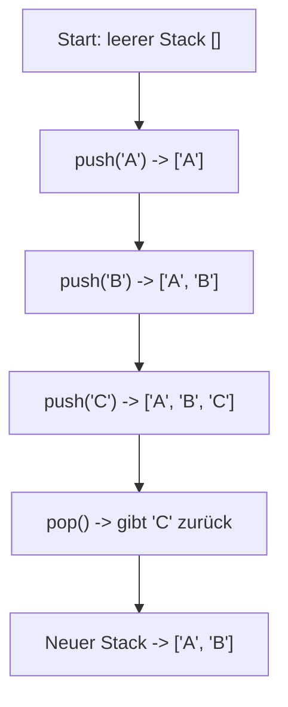
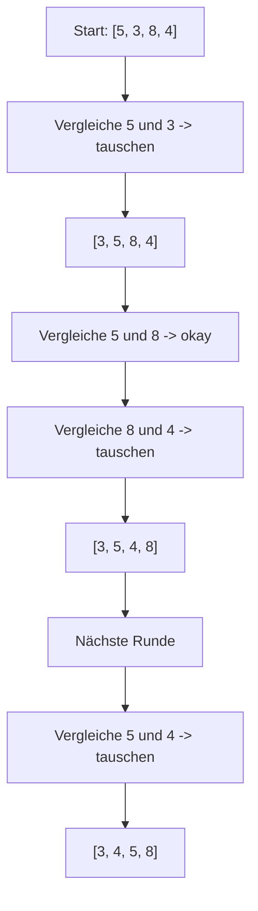

###### Themen

Datenstrukturen: Stacks und grundlegende Strukturvergleiche

- Unterschied zwischen Arrays und anderen grundlegenden Datenstrukturen auf einfachem Niveau
- Stack: Funktionsweise nach dem LIFO-Prinzip
- einfache Implementierung eines Stacks in JavaScript

Sortier- und Suchalgorithmen (grundlegend)

- lineare Suche in Arrays
- einfache Einführung in Sortierung am Beispiel von Bubble Sort
- grobe Einordnung von Laufzeit und Speicherbedarf an kleinen Beispielen

<br><br><br>
# 🧱 Datenstrukturen: Stacks und grundlegende Strukturvergleiche

Wenn du mit Node.js im Backend arbeitest, verarbeitest du ständig Daten: Listen von Benutzern, Caches, Requests, Logs, IDs, Jobs oder Zwischenergebnisse. Damit du solche Daten sinnvoll speichern und bearbeiten kannst, brauchst du Datenstrukturen.

Eine Datenstruktur ist im Grunde einfach eine Art, Daten zu organisieren. Unterschiedliche Datenstrukturen sind für unterschiedliche Aufgaben gut geeignet. Ein Array ist zum Beispiel praktisch, wenn du eine geordnete Liste brauchst. Ein Stack ist nützlich, wenn immer das zuletzt abgelegte Element zuerst wieder herausgenommen werden soll. Genau darum geht es hier.

<br><br><br>
## 🧩 Arrays und andere grundlegende Datenstrukturen einfach erklärt

Ein **Array** ist eine geordnete Liste von Werten. In JavaScript sind Arrays veränderbar, können wachsen oder schrumpfen und dürfen Werte verschiedener Typen enthalten ([Array - JavaScript | MDN](https://developer.mozilla.org/en-US/docs/Web/JavaScript/Reference/Global_Objects/Array)).

Ein einfaches Beispiel:

```js
const users = ["Anna", "Ben", "Chris"];
```

Hier hat jedes Element eine Position, also einen **Index**:

- `"Anna"` liegt an Position `0`
- `"Ben"` liegt an Position `1`
- `"Chris"` liegt an Position `2`

Der große Vorteil von Arrays ist: Du kannst über den Index sehr bequem auf Elemente zugreifen.

```js
console.log(users[1]); // Ben
```

Auf einem einfachen Niveau kann man sagen: Arrays sind gut, wenn du eine **Reihenfolge** hast und Elemente über ihre Position ansprechen willst.

Aber Arrays sind nicht die einzige Möglichkeit, Daten zu speichern.

<br><br><br>
### 📦 Wichtige grundlegende Datenstrukturen im Vergleich

| Struktur | Grundidee | Gut geeignet für | Weniger gut geeignet für | Typisches Beispiel im Node.js-Backend |
|---|---|---|---|---|
| **Array** | Geordnete Liste mit Index | Listen, Reihenfolgen, Schleifen, Sortieren | Sehr häufiges Suchen nach Werten ohne feste Position | Liste von Produkten, Logs, Suchergebnisse |
| **Objekt / Map** | Werte über Schlüssel speichern | Schnelles Nachschlagen per Schlüssel | Feste Reihenfolge ist nicht der Hauptzweck | Benutzer per ID finden |
| **Set** | Sammlung eindeutiger Werte | Doppelte Werte vermeiden | Geordnete Listen mit mehrfachen Einträgen | Bereits verarbeitete IDs merken |
| **Stack** | Letztes Element zuerst wieder herausnehmen | Rückgängig-Funktionen, verschachtelte Abläufe | Wenn das älteste Element zuerst raus soll | Verlauf, Parser, interne Verarbeitungsstapel |
| **Queue** | Erstes Element zuerst wieder herausnehmen | Warteschlangen, Jobs, Requests | Zugriff auf „das letzte zuerst“ | Job-Queue, Nachrichtenverarbeitung |
| **Verkettete Liste** | Elemente zeigen aufeinander | Häufiges Einfügen/Entfernen an bestimmten Stellen | Direkter Zugriff per Index | Eher konzeptionell wichtig, in JS nicht eingebaut |

Ein paar davon gibt es in JavaScript direkt eingebaut, andere eher als Konzept oder als eigene Implementierung.

Zum Beispiel:

- **Map** speichert Werte als Schlüssel-Wert-Paare ([Map - JavaScript | MDN](https://developer.mozilla.org/en-US/docs/Web/JavaScript/Reference/Global_Objects/Map)).
- **Set** speichert nur eindeutige Werte ([Set - JavaScript | MDN](https://developer.mozilla.org/en-US/docs/Web/JavaScript/Reference/Global_Objects/Set)).

Der wichtige Punkt ist: **Ein Array ist nicht automatisch die beste Lösung für jedes Problem.**

Wenn du zum Beispiel einen Benutzer über seine ID finden willst, ist ein `Map`-ähnlicher Zugriff oft gedanklich passender als eine lange Liste, durch die du suchen musst. Wenn du aber Daten in Reihenfolge darstellen oder sortieren willst, ist ein Array oft die natürlichste Wahl.

<br><br><br>
### 🔍 Der wichtigste Unterschied: Zugriff nach Position oder nach Prinzip

Viele Anfänger denken: „Datenstruktur ist Datenstruktur.“ Aber der Unterschied liegt oft darin, **wie** man auf Daten zugreift.

Ein Array sagt im Grunde:

> „Ich habe Elemente in einer Reihenfolge, und du kannst über die Position auf sie zugreifen.“

Ein Stack sagt dagegen:

> „Du darfst nur oben arbeiten. Was zuletzt hineingelegt wurde, kommt zuerst wieder heraus.“

Das ist ein sehr wichtiger Unterschied. Ein Stack ist also weniger eine bloße Liste und mehr eine **Regel**, wie mit einer Liste gearbeitet wird.

Darum wird ein Stack in JavaScript oft **mit einem Array umgesetzt**, obwohl ein Stack konzeptionell etwas anderes ist.

<br><br><br>
### 🧠 Arrays im Alltag von Node.js

Im Backend mit Node.js sind Arrays sehr häufig, zum Beispiel:

```js
const logs = [
  { level: "info", message: "Server gestartet" },
  { level: "error", message: "Datenbank nicht erreichbar" }
];
```

Oder:

```js
const productIds = [101, 205, 330, 412];
```

Arrays sind praktisch, wenn du:

- Daten aus einer Datenbank als Liste bekommst
- über mehrere Einträge iterieren willst
- sortieren oder filtern möchtest
- Ergebnisse gesammelt zurückgeben willst

Sobald du aber sagst: „Ich brauche eine bestimmte Zugriffslogik“, kommen andere Datenstrukturen ins Spiel. Und genau da ist der **Stack** ein gutes Einstiegsbeispiel.

<br><br><br>
## 📚 Stack: Funktionsweise nach dem LIFO-Prinzip

Ein **Stack** arbeitet nach dem **LIFO-Prinzip**. LIFO steht für **Last In, First Out**. Das bedeutet:

> Das Element, das zuletzt hineingelegt wurde, wird als erstes wieder entfernt.

Das ist das Grundprinzip eines Stacks ([Stack (abstract data type) - Wikipedia](https://en.wikipedia.org/wiki/Stack_(abstract_data_type))).

Ein sehr einfaches Bild dafür ist ein Stapel Teller:

- Du legst einen Teller oben drauf.
- Dann noch einen.
- Dann noch einen.
- Wenn du einen Teller nimmst, nimmst du den obersten.

Genau so funktioniert ein Stack.

<br><br><br>
### 🥞 Ein Bild dafür: Tellerstapel

Stell dir vor, du hast diesen Stack:

```text
Oben
[ C ]
[ B ]
[ A ]
Unten
```

Wenn du jetzt ein Element entfernst, bekommst du **C**. Danach liegt **B** oben. Danach **A**.

Also:

1. zuletzt hineingelegt: `C`
2. zuerst wieder heraus: `C`

Das ist LIFO.

<br><br><br>
### ⚙️ Typische Operationen eines Stacks

Ein Stack hat meist diese Grundoperationen:

| Operation | Bedeutung |
|---|---|
| `push` | Ein Element oben auf den Stack legen |
| `pop` | Das oberste Element entfernen und zurückgeben |
| `peek` / `top` | Das oberste Element anschauen, ohne es zu entfernen |
| `isEmpty` | Prüfen, ob der Stack leer ist |
| `size` | Anzahl der Elemente zurückgeben |

In JavaScript passen dazu besonders gut `push()` und `pop()` bei Arrays:

- `push()` fügt ein Element am Ende eines Arrays hinzu ([Array.prototype.push() - MDN](https://developer.mozilla.org/en-US/docs/Web/JavaScript/Reference/Global_Objects/Array/push))
- `pop()` entfernt das letzte Element eines Arrays und gibt es zurück ([Array.prototype.pop() - MDN](https://developer.mozilla.org/en-US/docs/Web/JavaScript/Reference/Global_Objects/Array/pop))

Genau deshalb wird ein Stack in JavaScript sehr oft intern mit einem Array gebaut.

<br><br><br>
### 🧭 So arbeitet ein Stack Schritt für Schritt



Wichtig dabei: Das „oberste“ Element ist hier einfach das **letzte Element im Array**.

<br><br><br>
### 🧠 Warum ist das im Backend überhaupt relevant?

Stacks sind nicht nur ein Schulbeispiel. Das Prinzip taucht an vielen Stellen auf.

Ein bekanntes Beispiel aus JavaScript selbst ist der **Call Stack**: Funktionsaufrufe werden stapelartig verarbeitet. Der zuletzt gestartete Funktionsaufruf wird zuerst beendet, was zur LIFO-Idee passt ([JavaScript execution model - MDN](https://developer.mozilla.org/en-US/docs/Web/JavaScript/Reference/Execution_model)).

Auch im Backend kann dir das Prinzip begegnen, zum Beispiel bei:

- verschachtelten Operationen
- Rückgängig-Mechanismen
- Parsern
- Klammerprüfung
- Tiefensuche in Datenstrukturen
- Verlauf von Zuständen

Ein Array speichert also nur Daten. Ein Stack gibt zusätzlich eine **Benutzungsregel** vor.

<br><br><br>
## 💻 Einfache Implementierung eines Stacks in JavaScript

Jetzt bauen wir selbst einen einfachen Stack in JavaScript.

<br><br><br>
### 🛠️ Variante 1: Stack mit einem Array

```js
class Stack {
  constructor() {
    this.items = [];
  }

  push(element) {
    this.items.push(element);
  }

  pop() {
    if (this.isEmpty()) {
      return undefined;
    }
    return this.items.pop();
  }

  peek() {
    if (this.isEmpty()) {
      return undefined;
    }
    return this.items[this.items.length - 1];
  }

  isEmpty() {
    return this.items.length === 0;
  }

  size() {
    return this.items.length;
  }
}
```

Verwendung:

```js
const stack = new Stack();

stack.push("A");
stack.push("B");
stack.push("C");

console.log(stack.peek());    // C
console.log(stack.pop());     // C
console.log(stack.pop());     // B
console.log(stack.size());    // 1
console.log(stack.isEmpty()); // false
```

Diese Implementierung ist bewusst einfach gehalten. Genau so sollte man einen Stack am Anfang verstehen.

<br><br><br>
### 🔍 Was passiert in den Methoden genau?

Die Methode `push(element)` legt ein neues Element oben auf den Stack. Weil wir das Ende des Arrays als „oben“ definieren, reicht `this.items.push(element)`.

Die Methode `pop()` entfernt das oberste Element. Da das oberste Element ebenfalls am Ende liegt, passt `this.items.pop()` perfekt.

Die Methode `peek()` schaut nur auf das letzte Element, ohne es zu löschen:

```js
this.items[this.items.length - 1]
```

Das ist ein häufiger Anfängerpunkt: `length` ist die Anzahl der Elemente, aber der letzte gültige Index ist immer `length - 1`.

Wenn das Array leer ist, soll `peek()` oder `pop()` sinnvoll reagieren. Hier geben wir `undefined` zurück. Das ist in JavaScript eine einfache und übliche Lösung.

<br><br><br>
### 📌 Warum nutzt man für einen Stack oft ein Array?

Weil ein Array in JavaScript die passenden Basisoperationen schon mitbringt. `push()` und `pop()` arbeiten am Ende des Arrays, und genau dort liegt in unserer Stack-Idee die Oberseite.

Das ist ein schönes Beispiel dafür, dass eine Datenstruktur manchmal auf einer anderen umgesetzt wird:

- **Array** = konkrete gespeicherte Liste
- **Stack** = Regel, wie man diese Liste benutzt

Das ist didaktisch sehr wichtig. Ein Stack ist also nicht einfach „noch ein anderes Wort für Array“. Stattdessen ist es eine **abstrakte Datenstruktur**, die man mit einem Array implementieren kann.

<br><br><br>
### 🌐 Ein kleines Node.js-nahes Beispiel

Stell dir vor, du willst in einem kleinen Backend die letzten bearbeiteten Zustände einer Konfiguration speichern, damit du bei einem Fehler zum vorherigen Zustand zurückspringen kannst:

```js
class Stack {
  constructor() {
    this.items = [];
  }

  push(element) {
    this.items.push(element);
  }

  pop() {
    return this.items.pop();
  }

  peek() {
    return this.items[this.items.length - 1];
  }
}

const configHistory = new Stack();

configHistory.push({ port: 3000, mode: "dev" });
configHistory.push({ port: 3001, mode: "dev" });
configHistory.push({ port: 4000, mode: "prod" });

console.log(configHistory.pop()); 
// { port: 4000, mode: "prod" }

console.log(configHistory.peek()); 
// { port: 3001, mode: "dev" }
```

Das zuletzt gespeicherte Setup wird zuerst zurückgenommen. Genau das ist Stack-Verhalten.

<br><br><br>
## 🔎 Sortier- und Suchalgorithmen (grundlegend)

Datenstrukturen und Algorithmen hängen eng zusammen. Eine Datenstruktur sagt dir, **wie Daten organisiert sind**. Ein Algorithmus sagt dir, **wie du mit diesen Daten arbeitest**.

Zwei sehr wichtige Grundideen sind:

- **Suchen**: Wie finde ich ein Element?
- **Sortieren**: Wie bringe ich Elemente in die richtige Reihenfolge?

Im Backend ist das dauernd relevant. Du suchst z. B. nach einem Benutzer in einer Liste oder sortierst Ergebnisse nach Preis, Datum oder Priorität.

<br><br><br>
## 🔍 Lineare Suche in Arrays

Die **lineare Suche** ist die einfachste Suchmethode. Du gehst ein Array von vorne nach hinten durch und prüfst jedes Element, bis du den gesuchten Wert gefunden hast. Genau das ist die Idee der linearen Suche ([Linear search - Wikipedia](https://en.wikipedia.org/wiki/Linear_search)).

Ein einfaches Beispiel:

```js
const ids = [12, 25, 30, 44, 57];
```

Wenn du `44` suchst, prüfst du nacheinander:

- `12`
- `25`
- `30`
- `44` ← gefunden

<br><br><br>
### 👣 Einfache Implementierung der linearen Suche

```js
function linearSearch(array, target) {
  for (let i = 0; i < array.length; i++) {
    if (array[i] === target) {
      return i; // Index des gefundenen Elements
    }
  }

  return -1; // nicht gefunden
}
```

Verwendung:

```js
const users = ["Anna", "Ben", "Chris", "Dina"];

console.log(linearSearch(users, "Chris")); // 2
console.log(linearSearch(users, "Eva"));   // -1
```

<br><br><br>
### 🧠 Wie denkt man darüber?

Lineare Suche ist einfach, weil sie keine besondere Vorbereitung braucht. Das Array muss nicht sortiert sein. Du schaust einfach Element für Element nach.

Der Nachteil ist: Wenn das gesuchte Element weit hinten liegt oder gar nicht vorhanden ist, musst du fast oder sogar komplett durch die Liste gehen.

Das macht lineare Suche bei kleinen Datenmengen völlig okay, aber bei großen Datenmengen oft langsam.

Im Node.js-Alltag passiert lineare Suche häufiger, als man denkt. Immer wenn du z. B. ein Array mit `for`, `find()` oder `findIndex()` durchläufst, steckt gedanklich oft genau dieses Prinzip dahinter.

<br><br><br>
### 📦 Beispiel aus dem Backend

```js
const users = [
  { id: 1, name: "Anna" },
  { id: 2, name: "Ben" },
  { id: 3, name: "Chris" }
];

function findUserById(users, id) {
  for (const user of users) {
    if (user.id === id) {
      return user;
    }
  }

  return null;
}
```

Wenn du `id = 3` suchst, prüfst du der Reihe nach:

1. Benutzer mit ID 1
2. Benutzer mit ID 2
3. Benutzer mit ID 3

Das ist lineare Suche in einem sehr realistischen Backend-Szenario.

<br><br><br>
## 🫧 Einfache Einführung in Sortierung am Beispiel von Bubble Sort

**Bubble Sort** ist ein sehr einfacher Sortieralgorithmus. Er vergleicht immer zwei benachbarte Elemente und vertauscht sie, wenn sie in der falschen Reihenfolge stehen. Dieser Vorgang wird wiederholt, bis alles sortiert ist ([Bubble sort - Wikipedia](https://en.wikipedia.org/wiki/Bubble_sort)).

Der Name kommt daher, dass größere Elemente bei aufsteigender Sortierung Schritt für Schritt nach „oben blubbern“.

Nehmen wir dieses Beispiel:

```js
[5, 3, 8, 4]
```

Vergleiche Schritt für Schritt:

1. `5` und `3` → falsch herum → tauschen  
   `[3, 5, 8, 4]`

2. `5` und `8` → okay  
   `[3, 5, 8, 4]`

3. `8` und `4` → falsch herum → tauschen  
   `[3, 5, 4, 8]`

Jetzt ist die größte Zahl schon am Ende.

Dann beginnt die nächste Runde:

1. `3` und `5` → okay  
2. `5` und `4` → tauschen  
   `[3, 4, 5, 8]`

Jetzt ist das Array sortiert.

<br><br><br>
### 🔁 Bubble Sort als Ablaufbild



<br><br><br>
### 🛠️ Einfache Implementierung von Bubble Sort in JavaScript

```js
function bubbleSort(array) {
  const arr = [...array]; // Kopie, damit das Original nicht verändert wird
  let swapped;

  do {
    swapped = false;

    for (let i = 0; i < arr.length - 1; i++) {
      if (arr[i] > arr[i + 1]) {
        const temp = arr[i];
        arr[i] = arr[i + 1];
        arr[i + 1] = temp;
        swapped = true;
      }
    }
  } while (swapped);

  return arr;
}
```

Verwendung:

```js
const numbers = [5, 3, 8, 4];
console.log(bubbleSort(numbers)); // [3, 4, 5, 8]
console.log(numbers);             // [5, 3, 8, 4]
```

<br><br><br>
### 🧠 Warum lernt man Bubble Sort überhaupt?

In echten Anwendungen ist Bubble Sort meistens **keine gute Wahl**, weil er für größere Datenmengen ineffizient ist. Trotzdem ist er didaktisch sehr wertvoll, weil du daran sehr gut verstehst:

- wie Vergleiche funktionieren
- wie Schleifen ineinandergreifen
- wie Tauschen funktioniert
- wie Sortierung schrittweise entsteht

Gerade am Anfang ist Bubble Sort deshalb ein guter Lernalgorithmus.

<br><br><br>
## ⏱️ Grobe Einordnung von Laufzeit und Speicherbedarf an kleinen Beispielen

Jetzt kommt ein sehr wichtiger Teil: **Wie teuer ist eine Operation?**

Damit meint man meistens zwei Dinge:

1. **Laufzeit**: Wie viel Arbeit muss der Algorithmus ungefähr machen?
2. **Speicherbedarf**: Wie viel zusätzlichen Speicher braucht er?

Dafür benutzt man oft die **Big-O-Notation**. Sie beschreibt grob, wie ein Algorithmus mit wachsender Eingabegröße skaliert ([Big O notation - Wikipedia](https://en.wikipedia.org/wiki/Big_O_notation)).

Du musst dabei am Anfang nicht mathematisch denken. Es reicht völlig, die Idee zu verstehen:

- `O(1)` bedeutet: ungefähr konstanter Aufwand
- `O(n)` bedeutet: Aufwand wächst ungefähr mit der Anzahl der Elemente
- `O(n²)` bedeutet: Aufwand wächst sehr stark, weil oft „alles mit allem“ verglichen wird

Hier steht `n` einfach für die Anzahl der Elemente.

<br><br><br>
### 📊 Vergleich der besprochenen Dinge

| Thema | Typische Laufzeit | Zusätzlicher Speicher | Einfach erklärt |
|---|---|---|---|
| Zugriff auf Array per Index | `O(1)` | `O(1)` | Du gehst direkt zur Position |
| Stack `push` | meist `O(1)` auf einfachem Lernniveau | `O(1)` pro Operation | Oben drauflegen |
| Stack `pop` | meist `O(1)` auf einfachem Lernniveau | `O(1)` | Oberstes Element wegnehmen |
| Stack `peek` | `O(1)` | `O(1)` | Nur das oberste ansehen |
| Lineare Suche | `O(n)` | `O(1)` | Im schlimmsten Fall alles durchsuchen |
| Bubble Sort | durchschnittlich und schlimmstenfalls `O(n²)` | `O(1)` bei in-place Variante | Viele Vergleiche und Vertauschungen |
| Bubble Sort mit Abbruch-Optimierung | best case `O(n)` | `O(1)` | Wenn schon sortiert, kann früh Schluss sein |

Bubble Sort hat im Durchschnitt und im schlimmsten Fall quadratische Laufzeit, und mit einer Optimierung kann der beste Fall linear sein ([Bubble sort - Wikipedia](https://en.wikipedia.org/wiki/Bubble_sort)).

<br><br><br>
### 🔢 Kleine Beispiele statt trockener Theorie

Nehmen wir lineare Suche.

Wenn du in einem Array mit 5 Elementen suchst, musst du im schlimmsten Fall 5 Vergleiche machen. Bei 1000 Elementen können es 1000 Vergleiche sein. Das ist die Idee von `O(n)`.

| Anzahl Elemente | Schlechtester Fall bei linearer Suche |
|---|---|
| 5 | 5 Prüfungen |
| 10 | 10 Prüfungen |
| 100 | 100 Prüfungen |
| 1000 | 1000 Prüfungen |

Bei Bubble Sort ist es deutlich teurer, weil sehr viele Paare verglichen werden.

Für kleine Listen ist das noch okay. Aber wenn die Liste größer wird, wird es schnell teuer:

| Anzahl Elemente | Ungefähr nötige Vergleiche bei Bubble Sort |
|---|---|
| 5 | 10 |
| 10 | 45 |
| 100 | 4950 |

Das zeigt sehr gut, warum `O(n²)` problematisch werden kann.

<br><br><br>
### 🧠 Laufzeit und Speicherbedarf ganz intuitiv

**Laufzeit** heißt nicht zwingend echte Sekunden auf der Uhr. Es geht eher darum, wie viele Arbeitsschritte ein Verfahren grob machen muss.

**Speicherbedarf** meint, wie viel extra Platz du zusätzlich brauchst.

Ein paar einfache Einordnungen:

- Die lineare Suche braucht fast keinen extra Speicher. Sie merkt sich im Grunde nur die Schleifenposition. Deshalb sagt man grob `O(1)` zusätzlicher Speicher.
- Ein Stack selbst wächst mit der Anzahl seiner Elemente. Wenn du 100 Elemente hineinlegst, musst du Platz für 100 Elemente haben. Das ist für die gespeicherten Daten grob `O(n)`.
- Bubble Sort kann direkt im selben Array arbeiten. Dann braucht der Algorithmus selbst nur sehr wenig extra Speicher, grob `O(1)`.
- Wenn du vor dem Sortieren eine Kopie des Arrays anlegst, wie in unserem Beispiel `const arr = [...array]`, dann brauchst du zusätzlich Platz für diese Kopie. Dann ist der zusätzliche Speicher praktisch höher als bei einer echten In-place-Variante.

Das ist ein guter Punkt für sauberes Denken: Laufzeit und Speicherbedarf hängen nicht nur vom Algorithmus ab, sondern auch davon, **wie genau du ihn implementierst**.

<br><br><br>
### 🌐 Was davon ist in Node.js besonders wichtig?

Im Backend arbeitest du oft nicht mit Millionen Elementen direkt im JavaScript-Speicher, weil vieles über Datenbanken gelöst wird. Trotzdem sind diese Grundlagen extrem wichtig.

Warum?

Weil du ständig Entscheidungen triffst wie:

- Suche ich in einem Array oder verwende ich eine Map?
- Muss ich überhaupt selbst sortieren, oder macht das besser die Datenbank?
- Ist eine einfache lineare Suche für 20 Einträge völlig ausreichend?
- Brauche ich eine Struktur mit klarer Zugriffsregel wie einen Stack?

Gerade in Node.js ist das sehr praxisnah. Kleine Datenmengen dürfen oft einfach gelöst werden. Aber wenn Daten wachsen, merkst du schnell, dass die Wahl der Datenstruktur und des Algorithmus einen Unterschied macht.

Ein einfaches Beispiel:

Wenn du 10 Konfigurationseinträge durchsuchen willst, ist lineare Suche völlig okay. Wenn du aber 100000 Einträge oft über eine ID finden musst, ist eine Struktur mit Schlüsselzugriff meist passender als jedes Mal von vorne durch ein Array zu laufen.

<br><br><br>
### 🧭 Die gedankliche Hauptlinie

Wenn du alles bisher richtig einordnen willst, dann so:

Ein **Array** ist eine allgemeine geordnete Liste.  
Ein **Stack** ist eine spezielle Art, mit einer Liste umzugehen: **zuletzt rein, zuerst raus**.  
Eine **lineare Suche** läuft ein Array Schritt für Schritt durch.  
**Bubble Sort** bringt Werte durch wiederholtes Vergleichen benachbarter Elemente in Reihenfolge.  
**Laufzeit** und **Speicherbedarf** helfen dir einzuschätzen, ob eine Lösung nur leicht verständlich oder auch für größere Datenmengen sinnvoll ist.

Genau diese Denkweise ist in der Backend-Entwicklung mit Node.js wichtig: nicht nur Code schreiben, sondern verstehen, **warum** eine Struktur oder ein Algorithmus zu einem Problem passt.