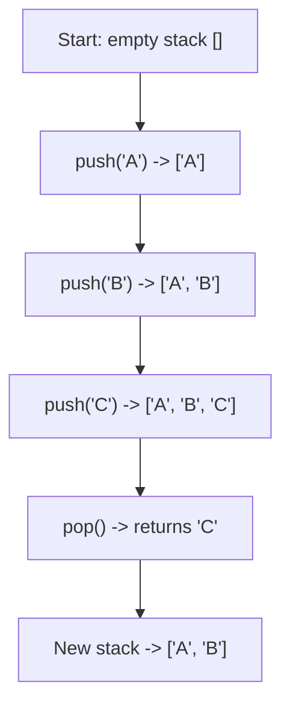
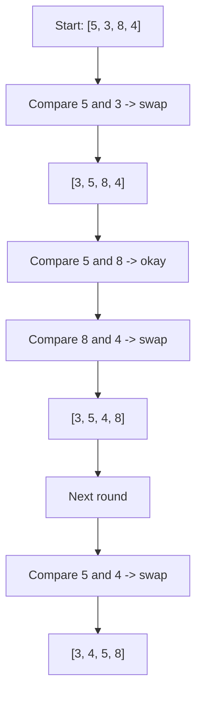

###### Topics

Data Structures: Stacks and Basic Structural Comparisons

- Difference between arrays and other basic data structures at a simple level
- Stack: How it works based on the LIFO principle
- Simple implementation of a stack in JavaScript

Sorting and Search Algorithms (basic)

- Linear search in arrays
- Simple introduction to sorting using Bubble Sort as an example
- Rough classification of runtime and memory usage with small examples

<br><br><br>
# 🧱 Data Structures: Stacks and Basic Structural Comparisons

When you work with Node.js on the backend, you're constantly processing data: lists of users, caches, requests, logs, IDs, jobs, or intermediate results. To store and process such data efficiently, you need data structures.

A data structure is basically just a way to organize data. Different data structures are good for different tasks. For example, an array is handy when you need an ordered list. A stack is useful when the item that was stored last should be taken out first. That’s what this is all about.

<br><br><br>
## 🧩 Arrays and Other Basic Data Structures Explained Simply

An **array** is an ordered list of values. In JavaScript, arrays are mutable, can grow or shrink, and can contain values of different types ([Array - JavaScript | MDN](https://developer.mozilla.org/en-US/docs/Web/JavaScript/Reference/Global_Objects/Array)).

A simple example:

```js
const users = ["Anna", "Ben", "Chris"];
```

Here, each element has a position, i.e., an **index**:

- `"Anna"` is at position `0`
- `"Ben"` is at position `1`
- `"Chris"` is at position `2`

The big advantage of arrays: you can access elements very conveniently using the index.

```js
console.log(users[1]); // Ben
```

At a simple level, you can say: Arrays are good if you have a **sequence** and want to access elements by their position.

But arrays aren't the only way to store data.

<br><br><br>
### 📦 Important Basic Data Structures Compared

| Structure | Basic Idea | Well-suited for | Less well-suited for | Typical Example in Node.js Backend |
|---|---|---|---|---|
| **Array** | Ordered list with index | Lists, sequences, loops, sorting | Very frequent search for values without fixed position | List of products, logs, search results |
| **Object / Map** | Storing values by key | Fast key-based lookup | Fixed order is not the main purpose | Finding a user by ID |
| **Set** | Collection of unique values | Avoiding duplicate values | Ordered lists with repeated entries | Tracking already processed IDs |
| **Stack** | Always remove the last element added first | Undo features, nested processes | When the oldest element should come out first | History, parser, internal processing stacks |
| **Queue** | Always remove the first element added first | Queues, jobs, requests | Accessing "the last one first" | Job queue, message processing |
| **Linked List** | Elements point to each other | Frequent insertion/removal at specific positions | Direct access by index | More conceptual importance, not built into JS |

Some of these exist as built-ins in JavaScript, others more as concepts or custom implementations.

For example:

- **Map** stores values as key-value pairs ([Map - JavaScript | MDN](https://developer.mozilla.org/en-US/docs/Web/JavaScript/Reference/Global_Objects/Map)).
- **Set** only stores unique values ([Set - JavaScript | MDN](https://developer.mozilla.org/en-US/docs/Web/JavaScript/Reference/Global_Objects/Set)).

The key point is: **An array is not automatically the best solution for every problem.**

If you want to find a user by their ID, a `Map`-like access is often more appropriate conceptually than a long list you have to search. But if you want to display or sort data in order, an array is often the most natural choice.

<br><br><br>
### 🔍 The Most Important Difference: Access by Position or Principle

Many beginners think: "A data structure is a data structure.” But the difference is often in **how** you access the data.

An array basically says:

> "I have elements in order, and you can access them by their position."

A stack, on the other hand, says:

> "You're only allowed to work on the top. Whoever was put in last comes out first."

That’s a very important difference. So, a stack is less a mere list and more a **rule** for how to work with a list.

That’s why, in JavaScript, a stack is often **implemented with an array**, even though a stack is conceptually something else.

<br><br><br>
### 🧠 Arrays in Everyday Node.js

In Node.js backend development, arrays are very common, for example:

```js
const logs = [
  { level: "info", message: "Server started" },
  { level: "error", message: "Database not reachable" }
];
```

Or:

```js
const productIds = [101, 205, 330, 412];
```

Arrays are practical when you:

- get data from a database as a list
- want to iterate over multiple entries
- want to sort or filter
- want to return results as a collection

But as soon as you say: "I need a specific access logic," other data structures come into play. This is exactly where the **stack** is a good starting example.

<br><br><br>
## 📚 Stack: How It Works Based on the LIFO Principle

A **stack** operates on the **LIFO principle**. LIFO stands for **Last In, First Out**. That means:

> The element that was last put in will be removed first.

That's the core principle of a stack ([Stack (abstract data type) - Wikipedia](https://en.wikipedia.org/wiki/Stack_(abstract_data_type))).

A very simple analogy is a stack of plates:

- You put a plate on top.
- Then another.
- Then another.
- If you take a plate, you take the top one.

That’s exactly how a stack works.

<br><br><br>
### 🥞 Visual Analogy: Stack of Plates

Imagine you have this stack:

```text
Top
[ C ]
[ B ]
[ A ]
Bottom
```

If you remove an element now, you get **C**. After that, **B** is on top. Then **A**.

So:

1. Last in: `C`
2. First out: `C`

That’s LIFO.

<br><br><br>
### ⚙️ Typical Stack Operations

A stack usually has these basic operations:

| Operation | Meaning |
|---|---|
| `push` | Add an element to the top of the stack |
| `pop` | Remove and return the top element |
| `peek` / `top` | Look at the top element without removing it |
| `isEmpty` | Check if the stack is empty |
| `size` | Return the number of elements |

In JavaScript, `push()` and `pop()` for arrays fit here especially well:

- `push()` adds an element to the end of an array ([Array.prototype.push() - MDN](https://developer.mozilla.org/en-US/docs/Web/JavaScript/Reference/Global_Objects/Array/push))
- `pop()` removes the last element of an array and returns it ([Array.prototype.pop() - MDN](https://developer.mozilla.org/en-US/docs/Web/JavaScript/Reference/Global_Objects/Array/pop))

That's exactly why a stack in JavaScript is often built internally with an array.

<br><br><br>
### 🧭 How a Stack Works Step by Step



Important: The “top” element is simply the **last element in the array**.

<br><br><br>
### 🧠 Why Is This Even Relevant in the Backend?

Stacks aren't just a textbook example. The principle appears in many places.

A well-known example from JavaScript itself is the **call stack**: Function calls are processed in a stack-like manner. The most recently started function call is finished first, fitting the LIFO idea ([JavaScript execution model - MDN](https://developer.mozilla.org/en-US/docs/Web/JavaScript/Reference/Execution_model)).

This principle also appears in the backend, for example with:

- nested operations
- undo mechanisms
- parsers
- bracket checking
- depth-first searches in data structures
- state histories

An array just stores data. A stack adds a **usage rule**.

<br><br><br>
## 💻 Simple Implementation of a Stack in JavaScript

Now, let's build a simple stack ourselves in JavaScript.

<br><br><br>
### 🛠️ Option 1: Stack with an Array

```js
class Stack {
  constructor() {
    this.items = [];
  }

  push(element) {
    this.items.push(element);
  }

  pop() {
    if (this.isEmpty()) {
      return undefined;
    }
    return this.items.pop();
  }

  peek() {
    if (this.isEmpty()) {
      return undefined;
    }
    return this.items[this.items.length - 1];
  }

  isEmpty() {
    return this.items.length === 0;
  }

  size() {
    return this.items.length;
  }
}
```

Usage:

```js
const stack = new Stack();

stack.push("A");
stack.push("B");
stack.push("C");

console.log(stack.peek());    // C
console.log(stack.pop());     // C
console.log(stack.pop());     // B
console.log(stack.size());    // 1
console.log(stack.isEmpty()); // false
```

This implementation is deliberately simple. This is exactly how you should understand a stack at first.

<br><br><br>
### 🔍 What Exactly Happens in the Methods?

The `push(element)` method puts a new element on top of the stack. Since we define the end of the array as “top,” `this.items.push(element)` is enough.

The `pop()` method removes the top element. Since the top is also at the end, `this.items.pop()` fits perfectly.

The `peek()` method simply looks at the last element, without deleting it:

```js
this.items[this.items.length - 1]
```

That's a frequent beginner point: `length` is the number of elements, but the last valid index is always `length - 1`.

If the array is empty, `peek()` or `pop()` should react sensibly. Here we return `undefined`. That's a simple and common solution in JavaScript.

<br><br><br>
### 📌 Why Use an Array for a Stack?

Because an array in JavaScript already provides the necessary basic operations. `push()` and `pop()` work at the end of the array, which is our stack’s top.

It’s a good example of a data structure being implemented with another one:

- **Array** = concrete stored list
- **Stack** = rule for how to use the list

This is didactically very important. So a stack isn’t just “another word for array.” Instead, it’s an **abstract data structure** that can be implemented with an array.

<br><br><br>
### 🌐 A Small Node.js-Oriented Example

Imagine you want to store the last processed states of a configuration in a small backend so you can roll back to a previous state if there's an error:

```js
class Stack {
  constructor() {
    this.items = [];
  }

  push(element) {
    this.items.push(element);
  }

  pop() {
    return this.items.pop();
  }

  peek() {
    return this.items[this.items.length - 1];
  }
}

const configHistory = new Stack();

configHistory.push({ port: 3000, mode: "dev" });
configHistory.push({ port: 3001, mode: "dev" });
configHistory.push({ port: 4000, mode: "prod" });

console.log(configHistory.pop()); 
// { port: 4000, mode: "prod" }

console.log(configHistory.peek()); 
// { port: 3001, mode: "dev" }
```

The last saved setup is undone first. That's precisely stack behavior.

<br><br><br>
## 🔎 Sorting and Search Algorithms (Basic)

Data structures and algorithms are closely related. A data structure tells you **how data is organized**. An algorithm tells you **how to work with that data**.

Two very important basic ideas are:

- **Searching**: How do I find an element?
- **Sorting**: How do I put elements in the right order?

This is always relevant in the backend. For example, you might search for a user in a list or sort results by price, date, or priority.

<br><br><br>
## 🔍 Linear Search in Arrays

**Linear search** is the simplest search method. You go through an array from front to back and check each element until you find the value you're looking for. That’s the idea behind linear search ([Linear search - Wikipedia](https://en.wikipedia.org/wiki/Linear_search)).

A simple example:

```js
const ids = [12, 25, 30, 44, 57];
```

If you search for `44`, you check one after the other:

- `12`
- `25`
- `30`
- `44` ← found

<br><br><br>
### 👣 Simple Implementation of Linear Search

```js
function linearSearch(array, target) {
  for (let i = 0; i < array.length; i++) {
    if (array[i] === target) {
      return i; // Index of found element
    }
  }

  return -1; // not found
}
```

Usage:

```js
const users = ["Anna", "Ben", "Chris", "Dina"];

console.log(linearSearch(users, "Chris")); // 2
console.log(linearSearch(users, "Eva"));   // -1
```

<br><br><br>
### 🧠 How Should You Think About It?

Linear search is simple because it requires no special preparation. The array doesn't need to be sorted. You just check each element.

The downside: If the target element is way at the end or not present at all, you almost or even completely go through the whole list.

This makes linear search perfectly fine for small datasets but often slow for large datasets.

In everyday Node.js code, linear search happens more often than you might think. Whenever you iterate through an array with `for`, `find()`, or `findIndex()`, this is the basic principle.

<br><br><br>
### 📦 Backend Example

```js
const users = [
  { id: 1, name: "Anna" },
  { id: 2, name: "Ben" },
  { id: 3, name: "Chris" }
];

function findUserById(users, id) {
  for (const user of users) {
    if (user.id === id) {
      return user;
    }
  }

  return null;
}
```

If you search for `id = 3`, you check in order:

1. User with ID 1
2. User with ID 2
3. User with ID 3

That's linear search in a very real backend scenario.

<br><br><br>
## 🫧 Simple Introduction to Sorting with Bubble Sort

**Bubble Sort** is a very simple sorting algorithm. It always compares two neighboring elements and swaps them if they’re in the wrong order. This process is repeated until everything is sorted ([Bubble sort - Wikipedia](https://en.wikipedia.org/wiki/Bubble_sort)).

The name comes from the fact that, with ascending sort, larger elements "bubble" up step by step.

Let’s take this example:

```js
[5, 3, 8, 4]
```

Step-by-step comparison:

1. `5` and `3` → wrong order → swap  
   `[3, 5, 8, 4]`

2. `5` and `8` → okay  
   `[3, 5, 8, 4]`

3. `8` and `4` → wrong order → swap  
   `[3, 5, 4, 8]`

Now the largest number is already at the end.

Then the next round begins:

1. `3` and `5` → okay  
2. `5` and `4` → swap  
   `[3, 4, 5, 8]`

Now the array is sorted.

<br><br><br>
### 🔁 Bubble Sort as a Flowchart



<br><br><br>
### 🛠️ Simple JavaScript Implementation of Bubble Sort

```js
function bubbleSort(array) {
  const arr = [...array]; // Copy, so original isn't modified
  let swapped;

  do {
    swapped = false;

    for (let i = 0; i < arr.length - 1; i++) {
      if (arr[i] > arr[i + 1]) {
        const temp = arr[i];
        arr[i] = arr[i + 1];
        arr[i + 1] = temp;
        swapped = true;
      }
    }
  } while (swapped);

  return arr;
}
```

Usage:

```js
const numbers = [5, 3, 8, 4];
console.log(bubbleSort(numbers)); // [3, 4, 5, 8]
console.log(numbers);             // [5, 3, 8, 4]
```

<br><br><br>
### 🧠 Why Learn Bubble Sort At All?

In real applications, Bubble Sort is mostly **not a good choice** because it’s inefficient for larger datasets. But it’s very valuable educationally, because it lets you understand:

- how comparisons work
- how loops interact
- how swapping works
- how sorting emerges step by step

Especially at the beginning, Bubble Sort is a good learning algorithm.

<br><br><br>
## ⏱️ Rough Classification of Runtime and Memory Usage with Small Examples

Now comes a very important part: **How expensive is an operation?**

This usually means two things:

1. **Runtime**: About how much work does the algorithm have to do?
2. **Memory usage**: How much additional memory does it need?

For this, the **Big O notation** is often used. It describes roughly how an algorithm scales with increasing input size ([Big O notation - Wikipedia](https://en.wikipedia.org/wiki/Big_O_notation)).

You don’t need to think mathematically at first. It’s enough to get the idea:

- `O(1)` means: roughly constant effort
- `O(n)` means: work grows roughly with the number of elements
- `O(n²)` means: work grows very quickly, because of "everything with everything" comparisons

Here, `n` is simply the number of elements.

<br><br><br>
### 📊 Comparison of the Discussed Topics

| Topic | Typical Runtime | Additional Memory | Explained Simply |
|---|---|---|---|
| Access array by index | `O(1)` | `O(1)` | Directly go to the position |
| Stack `push` | usually `O(1)` at a beginner level | `O(1)` per operation | Place it on top |
| Stack `pop` | usually `O(1)` at a beginner level | `O(1)` | Remove the top element |
| Stack `peek` | `O(1)` | `O(1)` | Just look at the top element |
| Linear search | `O(n)` | `O(1)` | In the worst case, search everything |
| Bubble Sort | average and worst-case `O(n²)` | `O(1)` for in-place version | Many comparisons and swaps |
| Bubble Sort with break optimization | best case `O(n)` | `O(1)` | If already sorted, can end early |

Bubble Sort has, on average and in the worst case, quadratic runtime, and with an optimization its best case can be linear ([Bubble sort - Wikipedia](https://en.wikipedia.org/wiki/Bubble_sort)).

<br><br><br>
### 🔢 Small Examples Instead of Dry Theory

Take linear search.

If you search an array with 5 elements, in the worst case you’ll make 5 comparisons. For 1000 elements, it could be 1000 comparisons. That’s the idea of `O(n)`.

| Number of Elements | Worst Case for Linear Search |
|---|---|
| 5 | 5 checks |
| 10 | 10 checks |
| 100 | 100 checks |
| 1000 | 1000 checks |

For Bubble Sort, it's much more expensive because many pairs are compared.

It’s still okay for small lists. But as the list gets larger, it gets expensive fast:

| Number of Elements | Approximate Comparisons for Bubble Sort |
|---|---|
| 5 | 10 |
| 10 | 45 |
| 100 | 4950 |

That shows clearly why `O(n²)` can be problematic.

<br><br><br>
### 🧠 Runtime and Memory Usage Intuitively

**Runtime** doesn't necessarily mean actual seconds on the clock. It’s more about how many work steps a method generally will perform.

**Memory usage** means how much extra space you need beyond the data itself.

A few simple classifications:

- Linear search requires almost no extra memory. It basically just keeps track of the loop position. That’s why you can say roughly `O(1)` extra memory.
- A stack itself grows with the number of elements you put in. Store 100 elements, you must have space for 100 elements. For the stored data, that's roughly `O(n)`.
- Bubble Sort can operate directly in the same array. Then, the algorithm itself needs very little extra memory, roughly `O(1)`.
- If you make a copy of the array before sorting, as in our example `const arr = [...array]`, you need more space for this copy. The additional memory is then practically higher than for a true in-place version.

This is a good point for clear thinking: Runtime and memory depend not only on the algorithm but also **how exactly you implement it**.

<br><br><br>
### 🌐 Which of This Matters Most in Node.js?

On the backend, you often don't work with millions of elements directly in JavaScript's memory, as a lot is handled through databases. Still, these basics are extremely important.

Why?

Because you constantly make decisions like:

- Do I search an array or use a Map?
- Do I even need to sort myself, or is it better done by the database?
- Is a simple linear search sufficient for 20 entries?
- Do I need a structure with strict access rules like a stack?

Especially in Node.js, this is very pragmatic. Small data sets can often be handled simply. But as data grows, you quickly notice that the choice of data structure and algorithm makes a difference.

A simple example:

If you want to search through 10 configuration entries, linear search is totally fine. But if you often have to find one out of 100,000 entries by ID, a structure with key access is usually more suitable than scanning an array from the beginning each time.

<br><br><br>
### 🧭 The Main Thought Line

If you want to put everything so far in the right perspective, then like this:

An **array** is a general ordered list.  
A **stack** is a special way to deal with a list: **last in, first out**.  
A **linear search** goes through an array step by step.  
**Bubble Sort** puts values in order by repeatedly comparing neighboring elements.  
**Runtime** and **memory usage** help you judge if a solution is not only easy to understand but also sensible for larger data sets.

This mindset is crucial in Node.js backend development: Not just writing code, but understanding **why** a structure or algorithm suits a problem.